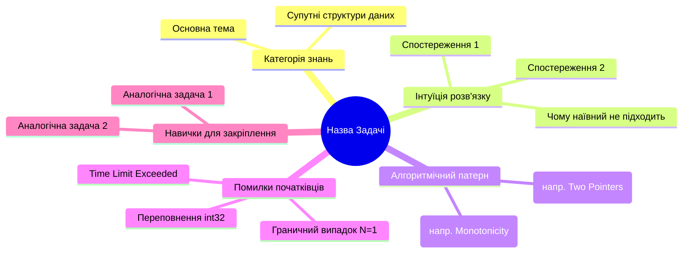

# Olympiad Mindmap & Knowledge Systematizer

Цей скіл відповідає за структурне відображення всіх алгоритмічних тем, зв'язків між ними та декомпозицію конкретних задач у зрозумілі інтерактивні карти.

---

## Формати ментальних карт (Mermaid)

### 1. Карта знань задачі (Problem Anatomy Mindmap)
Використовується для кожного детального розбору задачі:

### 2. Загальна карта олімпіадних дисциплін (The Grand CP Tree)
- **Базові алгоритми:** Префіксні суми, Two Pointers, Двійковий пошук, Сортування, Жадібні.
- **Динамічне програмування (DP):** 1D/2D, Рюкзак, LIS/LCS, ДП по масках (Bitmask DP), ДП на деревах, ДП по цифрах (Digit DP), Оптимізації ДП (Convex Hull Trick, Divide and Conquer DP).
- **Теорія графів:** BFS/DFS, Дейкстра, Флойд, Топологічне сортування, Мінімальне кістякове дерево (Kruskal/Prim), Потоки (Dinic, Push-Relabel), 2-SAT, Ейлерів цикл.
- **Дерева та структури даних:** DSU (Union-Find), Дерево відрізків (Segment Tree) + Lazy Propagation, Дерево Фенвіка, Бор (Trie), Декартове дерево (Treap).
- **Теорія чисел та комбінаторика:** Решето Ератосфена, Розширений алгоритм Евкліда, Модулярна арифметика, Біноміальні коефіцієнти, Швидке піднесення до степеня, Матричне множення.
- **Рядки:** Поліноміальне хешування, Префікс-функція (KMP), Z-функція, Бор, Автомат Ахо-Корасік.
