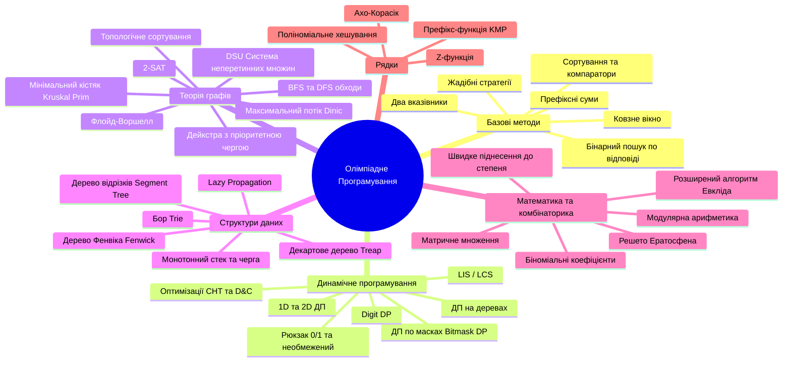

# 🚀 Super-Algo: Екосистема підготовки олімпіадної команди у ТОП

Система автоматизованого тренінгу, аналізу та декомпозиції алгоритмічних задач (Codeforces, LeetCode, AtCoder, CSES, ICPC, Всеукраїнські олімпіади).

---

## 🗺️ Генеральна ментальна карта олімпіадних знань (CP Grand Mind Map)



---

## 🧩 Готові суб-агенти (Subagents)

У середовищі активовано 3 спеціалізовані агенти:
1. **`algo-coach`** — Ментор, який пояснює "для чайників", будує інтуїцію вирішення, порівнює наївний підхід з оптимальним.
2. **`algo-mindmapper`** — Систематизатор, який будує індивідуальні Mermaid Mind Map для кожної розібраної задачі.
3. **`algo-contest-tester`** — Стрес-тестувальник, який пише рандомайзери тестів і знаходить приховані баги до здачі.

---

## 🔌 Безкоштовне розширення для турів та олімпіад

Для збору задач і тестів в 1 клік використовується **Competitive Companion**:
- **Підтримує:** Codeforces, AtCoder, LeetCode, CSES, HackerRank, Kattis та 115+ суддівських систем.
- **Встановлення:** Безкоштовне розширення для Chrome Web Store або Firefox Add-ons.
- **Як користуватися в нашому проекті:**
  1. Запустіть локальний слухач:
     ```bash
     python scripts/companion_listener.py
     ```
  2. Відкрийте будь-яку задачу або контест у браузері.
  3. Натисніть зелену іконку **`+`** (або `Ctrl+Shift+U`).
  4. Задача, зразки тестів, шаблон коду на C++/Python та тестувальник автоматично створяться у папці `tasks/`!

---

## 🌳 Інтерактивний HTML-додаток "Дерево Навичок Команди"

Створено повноцінний сучасний веб-візуалізатор [web/index.html](file:///C:/project/super-algo/web/index.html) для відстеження прогресу кожного учасника олімпіадної команди:
- **Перемикання учасників:** Капітан, Спеціаліст з математики, Тестувальник або додавання нових членів команди.
- **Статуси тем:** `0 - Не вивчено`, `1 - Теорія (50%)`, `2 - Освоєно (100%)`, `3 - Контест-майстер ⭐ (150%)`.
- **Лічильник розв'язаних задач & Нотатки:** Збереження підводних каменів до кожної теми.
- **Радар Команди (Spider/Radar Chart):** Наочне порівняння покриття тем учасниками для ідеального балансу в ICPC.
- **Локальне збереження, Експорт та Імпорт:** Автозбереження в LocalStorage браузера та експорт/імпорт у JSON.

**Швидкий запуск візуалізатора:**
```bash
python scripts/open_visualizer.py
```
або просто відкрийте у браузері файл `web/index.html`.

---

## 🧪 Рушій стрес-тестування (Stress-Testing Engine)

Якщо розв'язок отримує Wrong Answer (WA) на невідомому олімпіадному тесті:
```bash
python scripts/stress_tester.py generator.py solution.py naive.py 1000
```
Скрипт згенерує до 1000 тестів, знайде першу невідповідність між швидким розв'язком і наївним перебором та збереже мінімальний контрприклад у `failing_test.txt`.

---

## 🏆 База Задач UCPC 2026 (100% Coverage)

- **UCPC 2026 I Етап (14/14 задач):**
  * `problem_A_antivirus` ... `problem_N_weather_diary`
  * Запуск перевірки: `python tasks/test_all_stage1.py`
- **UCPC 2026 Пробний тур / Eolymp Practice (10/10 задач):**
  * `problem_A_standard1_sum_ab` ... `problem_F_standard6_distinct_segments`
  * `problem_G_interactive1_guess_number` (Інтерактивна задача)
  * `problem_H_multiplerun1_encode_decode` (Multi-run протокол)
  * `problem_I_outputonly1_eight_queens` (Output-only)
  * `problem_J_functionnomain1_max_pair_sum` (Бібліотечна функція без main)
  * Запуск перевірки: `python tasks/test_all_practice.py`

---

## 📚 Повна Документація

- 📘 **[USER_GUIDE.md](file:///C:/project/super-algo/USER_GUIDE.md)** — Повна інструкція користувача: веб-інтерфейс, шпори, SRS, скрапери, лінтери, контест-пам'ятка.
- 🎯 **[docs/PROBLEM_KEYWORDS_AND_MARKERS.md](file:///C:/project/super-algo/docs/PROBLEM_KEYWORDS_AND_MARKERS.md)** — Словник слів-маркерів та логічних тригерів: як за 60 секунд розпізнати алгоритм за формулюванням умови.
- ⚡ **[AGENTS.md](file:///C:/project/super-algo/AGENTS.md)** — Бойовий регламент, 8-кроковий стандарт розбору задач, інваріанти, правила коду.
- 🗺️ **[ROADMAP.md](file:///C:/project/super-algo/ROADMAP.md)** — 5-рівнева декомпозиція та дорожня карта підготовки до ICPC / IOI.
- 🌳 **[docs/ALGORITHM_DECISION_TREE.md](file:///C:/project/super-algo/docs/ALGORITHM_DECISION_TREE.md)** — Дерево вибору алгоритмів за обмеженнями та структурами.


