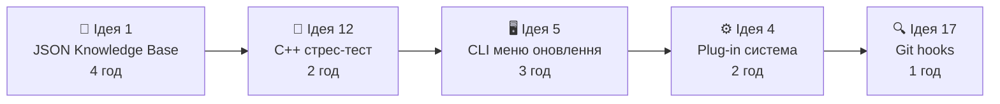
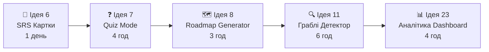
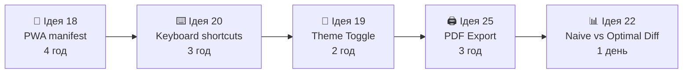
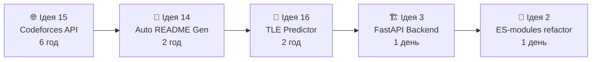
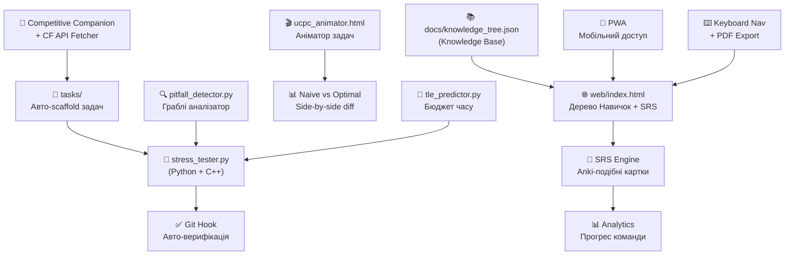

# 🚀 Super-Algo: 25 Ідей Покращення + Великий План Реалізації

> Аналіз проведено 2026-10-07. Проект є потужною екосистемою олімпіадної підготовки з 5-рівневою декомпозицією, стрес-тестером, Competitive Companion listener та анімованим розбором задач.

---

## 🔬 Аналіз поточного стану

### ✅ Що вже чудово працює
| Компонент | Стан |
|---|---|
| `web/index.html` — Дерево навичок + Радар команди | ✅ Повноцінний |
| `web/ucpc_animator.html` — Покроковий аніматор | ✅ 3181 рядок, деталізований |
| `scripts/stress_tester.py` — Стрес-тест движок | ✅ Працює |
| `scripts/companion_listener.py` — Auto-scaffold | ✅ Повноцінний |
| `docs/ALGORITHM_DECISION_TREE.md` — Дерево рішень | ✅ Mermaid, 5 гілок |
| 5-рівнева база знань у `KNOWLEDGE_TREE` | ✅ Вбудована в `index.html` |
| 18 задач UCPC 2026 (14 + 4) з розборами | ✅ Повне покриття |

### ⚠️ Що потребує покращення
- **Знання жорстко зашиті** в HTML → складно масштабувати
- **Немає спейсід-репетиції (SRS)** — Anki-подібної системи
- **Один HTML-файл** ~190 KB → повільне завантаження, важко підтримувати
- **Немає API/бекенду** → дані в LocalStorage, не синхронізуються між пристроями
- **Companion Listener** не підтримує C++ компіляцію
- **Стрес-тестер** лише для Python, не підтримує C++ бінарники
- **Немає системи контестів/архіву** задач з тегами
- **Відсутня мобільна версія** (web-додаток)

---

## 💡 25 Ідей Покращення

### 🏗️ БЛОК 1: Архітектура та Масштабованість (Ідеї 1–5)

#### Ідея 1 — Винести Knowledge Base в JSON/YAML ✨ ПРІОРИТЕТ #1
**Проблема:** Знання вбудовані прямо в `index.html` в `const KNOWLEDGE_TREE = [...]` (~700 рядків JS).  
**Рішення:** Виокремити в `docs/knowledge_tree.json` та завантажувати через `fetch()`.  
**Профіт:** Редагування знань без торкання HTML. Агент може патчити JSON-файл автоматично.  
**Складність:** 🟢 Легко (4 год)

```
docs/
  knowledge_tree.json       ← нано-інсайти, інваріанти, граблі
  contest_matrix.json       ← матриця задач контестів
web/
  index.html                ← тільки UI-логіка, fetch("../docs/knowledge_tree.json")
```

#### Ідея 2 — Модульний HTML (index → Vite/Vanilla Multi-page App) 🏗️
**Проблема:** `index.html` 1917 рядків, `ucpc_animator.html` 3181 рядок — важко підтримувати.  
**Рішення:** Розбити на компоненти через Vite або bare ES-modules.  
**Профіт:** Чистіший код, швидке завантаження, tree-shaking.  
**Складність:** 🟡 Середньо (1 день)

```
web/src/
  components/
    SkillTree.js
    Decomposition.js
    MindMap.js
    ProblemAnimator.js
  data/
    knowledge.js   ← import від JSON
```

#### Ідея 3 — REST API Бекенд (FastAPI) для збереження прогресу
**Проблема:** Прогрес зберігається тільки в LocalStorage → втрачається при очищенні браузера.  
**Рішення:** Мінімальний `FastAPI` сервер з SQLite для збереження прогресу команди.  
**Профіт:** Синхронізація між пристроями, центральна база знань команди.  
**Складність:** 🟡 Середньо (1 день)

```
api/
  main.py               ← FastAPI app
  models.py             ← Pydantic models
  database.py           ← SQLite через SQLAlchemy
  routers/
    progress.py
    problems.py
```

#### Ідея 4 — Плагінна Система для Нових Контестів
**Проблема:** Щоб додати новий контест (UCPC 2027), потрібно вручну редагувати HTML.  
**Рішення:** Система `contest_plugins/` — кожен контест є окремим JSON-файлом.  
**Профіт:** Додавання нового контесту = 1 JSON-файл, без коду.  
**Складність:** 🟢 Легко (2 год)

```
contest_plugins/
  ucpc2026_stage1.json
  ucpc2026_practice.json
  codeforces_round_xyz.json    ← новий тур = новий файл
```

#### Ідея 5 — CLI-команди через `super-algo.bat` / `menu.py`
**Проблема:** Запуск інструментів вимагає знати точні команди.  
**Рішення:** Інтерактивне CLI-меню через `python scripts/menu.py`.  
**Профіт:** Новий учасник запускає все з одного меню.  
**Складність:** 🟢 Легко (3 год)

```
=== Super-Algo CLI ===
[1] 🌐 Відкрити Дерево Навичок
[2] 🎬 Відкрити Аніматор UCPC 2026
[3] 🧪 Запустити стрес-тест
[4] 📡 Запустити Competitive Companion listener
[5] 📊 Дашборд прогресу команди
[6] 🔄 Оновити базу знань з JSON
```

---

### 📚 БЛОК 2: Навчання та Засвоєння Матеріалу (Ідеї 6–11)

#### Ідея 6 — Spaced Repetition System (SRS / Anki-подібна) 🧠 ПРІОРИТЕТ #2
**Проблема:** Нано-інсайти та граблі читаються один раз і забуваються.  
**Рішення:** Картковий режим у `web/index.html` з SM-2 алгоритмом (як Anki).  
**Профіт:** Автоматичне повторення слабких місць. "Коли наступний раз повторити `s = (s-1) & mask`?"  
**Складність:** 🟡 Середньо (1 день)

```
SRS картка:
┌─────────────────────────────────┐
│ 🃏 Нано-інсайт                  │
│                                 │
│ Як безпечно перебрати всі       │
│ підмаски маски без зациклення?  │
│                                 │
│ [Показати відповідь]            │
└─────────────────────────────────┘
       ↓ після відповіді
┌─────────────────────────────────┐
│ for(int s=mask; s; s=(s-1)&mask)│
│ + окремо s=0                    │
│                                 │
│ [Легко ✅] [Важко ❌] [Знов 🔄] │
└─────────────────────────────────┘
```

#### Ідея 7 — Режим "Олімпіадне Інтерв'ю" (Quiz Mode)
**Проблема:** Немає способу перевірити себе без відкритих підказок.  
**Рішення:** Режим запитань де показується умова задачі → треба вибрати алгоритм.  
**Профіт:** Тренування рефлексу вибору алгоритму за 30 секунд.  
**Складність:** 🟢 Легко (4 год)

#### Ідея 8 — Roadmap / Learning Path Generator
**Проблема:** Новачок не знає з чого починати.  
**Рішення:** Кнопка "Побудувати Roadmap" — вибираєш рівень (початківець/середній/топ) → генерується особистий план навчання.  
**Профіт:** Структурований шлях замість хаосу.  
**Складність:** 🟢 Легко (3 год)

#### Ідея 9 — Режим "Поєдинок" (Two-Player Battle Mode)
**Проблема:** Немає змагального елементу при навчанні.  
**Рішення:** Два учасники команди отримують одне запитання і змагаються хто швидше відповість.  
**Профіт:** Геймифікація + виявлення слабких місць через порівняння.  
**Складність:** 🔴 Складно (2 дні, потребує WebSocket)

#### Ідея 10 — Система "Щоденний Виклик" (Daily Challenge)
**Проблема:** Немає регулярної практики.  
**Рішення:** Щодня о 9:00 — нова задача/нано-інсайт з бази знань для повторення.  
**Профіт:** Регулярність + навичка вирішувати під тиском часу.  
**Складність:** 🟢 Легко (2 год)

#### Ідея 11 — "Граблі Детектор" (Common Mistake Highlighter) 🔍
**Проблема:** Олімпіадники повторюють одні й ті ж помилки.  
**Рішення:** Аналізатор коду який шукає типові граблі: `1 << k` (без `1LL`), `endl` замість `'\n'`, відсутність `long long`.  
**Профіт:** Автоматична перевірка коду перед здачею.  
**Складність:** 🟡 Середньо (6 год, Python regex/AST)

```python
# scripts/pitfall_detector.py
def detect_pitfalls(code: str) -> list[str]:
    warnings = []
    if re.search(r'1\s*<<\s*[3-9]\d', code) and '1LL' not in code:
        warnings.append("⚠️ Можливий overflow: використай 1LL << k")
    if 'endl' in code:
        warnings.append("⚠️ endl = flush + '\n'. Використай '\n' для швидкості")
    ...
    return warnings
```

---

### 🔧 БЛОК 3: Інструменти та Автоматизація (Ідеї 12–17)

#### Ідея 12 — Покращений Стрес-Тест з підтримкою C++ 🛠️ ПРІОРИТЕТ #3
**Проблема:** `stress_tester.py` підтримує тільки Python.  
**Рішення:** Авто-компіляція `.cpp` → бінарник → порівняння.  
**Профіт:** Стрес-тест рідного C++ коду без ручної компіляції.  
**Складність:** 🟢 Легко (2 год)

```python
# Нова логіка в stress_tester.py
def compile_if_needed(path: str) -> str:
    if path.endswith(".cpp"):
        exe = path.replace(".cpp", "_exe")
        subprocess.run(["g++", "-O2", "-o", exe, path], check=True)
        return exe
    return f"python {path}"
```

#### Ідея 13 — Auto-Generator для Дерев та Графів
**Проблема:** Генератори тестів пишуться вручну для кожної задачі.  
**Рішення:** Бібліотека `scripts/test_gen_lib.py` з готовими функціями.  
**Профіт:** Генерація бамбука, зірки, ланцюга, рандомного дерева одним рядком.  
**Складність:** 🟢 Легко (4 год)

```python
from test_gen_lib import gen_tree, gen_graph, gen_array
tree = gen_tree(n=1000, type="bamboo")  # або "star", "random", "caterpillar"
graph = gen_graph(n=100, m=500, connected=True, weighted=True)
```

#### Ідея 14 — Автоматичний README Генератор (8 кроків)
**Проблема:** Кожен README.md пишеться вручну з 8 кроками.  
**Рішення:** Скрипт `scripts/gen_readme.py` — агент заповнює шаблон за JSON задачі.  
**Профіт:** Стандартизований README за 30 секунд.  
**Складність:** 🟢 Легко (2 год)

#### Ідея 15 — Інтеграція з Codeforces API
**Проблема:** Задачі додаються вручну.  
**Рішення:** `scripts/cf_fetcher.py` — завантажує умову задачі через CF API за `contest_id` + `problem_id`.  
**Профіт:** `python scripts/cf_fetcher.py 1234 A` → готовий шаблон задачі.  
**Складність:** 🟡 Середньо (6 год)

#### Ідея 16 — TLE Predictor (Визначення O-складності)
**Проблема:** Важко визначити чи пройде O(N log N) при N=10^6.  
**Рішення:** Утиліта `scripts/tle_predictor.py` — вводиш N та O-складність → показує чи вкладається в ліміт часу.  
**Профіт:** Швидка перевірка бюджету часу.  
**Складність:** 🟢 Легко (2 год)

```
python scripts/tle_predictor.py --n 1000000 --complexity "N log N" --tl 2
✅ O(N log N) при N=10^6: ~20M операцій → безпечно (ліміт 2с)
```

#### Ідея 17 — Git Hooks для Автоматичної Верифікації
**Проблема:** Код здається без перевірки тестів.  
**Рішення:** `pre-commit` hook — автоматично запускає `test_runner.py` перед кожним commit.  
**Профіт:** Ніколи не закомітиш зламаний код.  
**Складність:** 🟢 Легко (1 год)

---

### 🌐 БЛОК 4: Веб-Інтерфейс та UX (Ідеї 18–22)

#### Ідея 18 — PWA (Progressive Web App) для мобільного доступу 📱
**Проблема:** Немає мобільного доступу до бази знань.  
**Рішення:** Додати `manifest.json` + `service-worker.js` → `index.html` стає PWA.  
**Профіт:** Встановлюється на телефон, працює офлайн, SRS-картки в дорозі.  
**Складність:** 🟢 Легко (4 год)

#### Ідея 19 — Dark/Light Theme Toggle + Кастомізація кольорів
**Проблема:** Тільки темна тема, немає персоналізації.  
**Рішення:** Toggle dark/light + збереження теми в LocalStorage.  
**Профіт:** Зручне використання при яскравому освітленні.  
**Складність:** 🟢 Легко (2 год)

#### Ідея 20 — Keyboard Shortcut Navigation ⌨️
**Проблема:** Навігація тільки мишкою.  
**Рішення:** Keyboard shortcuts: `Ctrl+K` → швидкий пошук, `1-4` → переключення вкладок, `Space` → наступний крок аніматора.  
**Профіт:** Олімпіадники звикли до клавіатури, це природно для них.  
**Складність:** 🟢 Легко (3 год)

#### Ідея 21 — "Ремікс Задачі" — Live Code Playground
**Проблема:** Нема де швидко протестувати ідею прямо в браузері.  
**Рішення:** Вбудований Monaco Editor (VS Code engine) + Pyodide (Python у браузері) → запуск коду онлайн.  
**Профіт:** Можна запускати Python прямо у аніматорі, без відкриття IDE.  
**Складність:** 🔴 Складно (2 дні)

#### Ідея 22 — Візуальний Diffing між Наївним та Оптимальним
**Проблема:** Важко наочно порівняти два алгоритми.  
**Рішення:** Анімація side-by-side: ліворуч наївний O(N²), праворуч оптимальний O(N log N) — обидва на одному вході.  
**Профіт:** Миттєве "aha moment" чому оптимальний швидший.  
**Складність:** 🟡 Середньо (1 день)

---

### 📊 БЛОК 5: Аналітика та Командна Динаміка (Ідеї 23–25)

#### Ідея 23 — Dashboard Прогресу з Графіками 📈 ПРІОРИТЕТ #4
**Проблема:** Прогрес відображається як числа, немає тренду.  
**Рішення:** Нова вкладка "Аналітика" з Chart.js графіками прогресу по тижнях.  
**Профіт:** Видно де є стагнація, де є ривок.  
**Складність:** 🟢 Легко (4 год)

```
Вкладка Аналітика:
📈 Графік прогресу по тижнях (line chart)
🗺️ Heatmap активності (GitHub-style)
🏆 Leaderboard команди
📋 Слабкі теми (pie chart)
```

#### Ідея 24 — Система Досягнень (Achievements / Badges) 🏅
**Проблема:** Немає мотивації продовжувати вчитись.  
**Рішення:** Badges за прогрес: "Перші 5 тем освоєно", "Майстер Bitmask DP", "100 задач вирішено".  
**Профіт:** Геймифікація → більше залучення.  
**Складність:** 🟢 Легко (3 год)

#### Ідея 25 — Export у PDF/PNG для Шпаргалок
**Проблема:** Не можна роздрукувати Mind Map або Нано-таблицю для використання на папері.  
**Рішення:** Кнопка "Print-ready PDF" — генерує чисту PDF-шпаргалку через `html2pdf.js`.  
**Профіт:** Фізична шпаргалка на олімпіаді (де дозволені папери).  
**Складність:** 🟢 Легко (3 год)

---

## 🗓️ ВЕЛИКИЙ ПЛАН РЕАЛІЗАЦІЇ

### Фаза 0: Фундамент (Тиждень 1) — "Очистити архітектуру"



**Конкретні кроки:**

| # | Дія | Файли | Час |
|---|-----|-------|-----|
| 1 | Витягти `KNOWLEDGE_TREE` з `index.html` → `docs/knowledge_tree.json` | `index.html`, `docs/knowledge_tree.json` | 2 год |
| 2 | Замінити `const KNOWLEDGE_TREE = [...]` на `fetch('../docs/knowledge_tree.json')` | `web/index.html` | 1 год |
| 3 | Додати C++ компіляцію у `stress_tester.py` | `scripts/stress_tester.py` | 2 год |
| 4 | Написати `scripts/test_gen_lib.py` з `gen_tree`, `gen_graph`, `gen_array` | `scripts/test_gen_lib.py` | 4 год |
| 5 | Оновити `scripts/menu.py` з інтерактивним меню | `scripts/menu.py` | 3 год |
| 6 | Додати `.git/hooks/pre-commit` → `python tasks/test_all_stage1.py` | `.git/hooks/pre-commit` | 1 год |

---

### Фаза 1: Навчальний Движок (Тиждень 2) — "Навчатись ефективно"



**Конкретні кроки:**

| # | Дія | Файли | Час |
|---|-----|-------|-----|
| 7 | Додати вкладку "Картки SRS" в `index.html` з SM-2 алгоритмом | `web/index.html` | 1 день |
| 8 | Написати Quiz Mode (вибір алгоритму за умовою задачі) | `web/index.html` | 4 год |
| 9 | Написати `scripts/pitfall_detector.py` (regex-аналізатор граблів) | `scripts/pitfall_detector.py` | 6 год |
| 10 | Додати вкладку "Аналітика" з Chart.js: прогрес по тижнях, heatmap | `web/index.html` | 4 год |
| 11 | Додати систему Achievements у `web/index.html` | `web/index.html` | 3 год |

---

### Фаза 2: UX та Мобільність (Тиждень 3) — "Доступно скрізь"



**Конкретні кроки:**

| # | Дія | Файли | Час |
|---|-----|-------|-----|
| 12 | Створити `web/manifest.json` + `web/sw.js` (service worker) | `web/manifest.json`, `web/sw.js` | 4 год |
| 13 | Додати keyboard shortcuts в `index.html` | `web/index.html` | 3 год |
| 14 | Dark/Light toggle + CSS variables | `web/index.html` | 2 год |
| 15 | Кнопка "Export PDF" через `html2pdf.js` | `web/index.html`, `web/ucpc_animator.html` | 3 год |
| 16 | Side-by-side аніматор Naive vs Optimal | `web/ucpc_animator.html` | 1 день |

---

### Фаза 3: Масштабування (Тиждень 4) — "Система, що росте"



**Конкретні кроки:**

| # | Дія | Файли | Час |
|---|-----|-------|-----|
| 17 | Написати `scripts/cf_fetcher.py` (CF API → scaffold задачі) | `scripts/cf_fetcher.py` | 6 год |
| 18 | Написати `scripts/gen_readme.py` (автоматичний 8-крокових README) | `scripts/gen_readme.py` | 2 год |
| 19 | Написати `scripts/tle_predictor.py` (бюджет часу за N та O) | `scripts/tle_predictor.py` | 2 год |
| 20 | Ініціалізувати FastAPI бекенд з SQLite | `api/main.py` | 1 день |
| 21 | Рефакторинг `index.html` на ES-modules | `web/src/` | 1 день |

---

## 📊 Пріоритетна Матриця (Impact vs Effort)

```
IMPACT
  │
  │   [6] SRS         [12] C++ Stress    [1] JSON KB ✨
  │   [23] Dashboard  [11] Pitfall       [18] PWA
  │                   [15] CF API
  │
  │   [21] Playground [3] FastAPI        [7] Quiz
  │   [9] Battle Mode [22] Diff Anim     [8] Roadmap
  │
  │                                      [10] Daily
  └─────────────────────────────────────────────────→ EFFORT
    Складно          Середньо            Легко
```

### 🥇 ТОП-5 за "найбільший impact за мінімум зусиль":
1. **Ідея 1** — JSON Knowledge Base (4 год → фундамент для всього)
2. **Ідея 6** — SRS Картки (1 день → радикально краще засвоєння)
3. **Ідея 12** — C++ стрес-тест (2 год → одразу корисно на контесті)
4. **Ідея 23** — Dashboard аналітики (4 год → видно прогрес)
5. **Ідея 11** — Граблі Детектор (6 год → запобігає WA)

---

## 🎯 Загальна Архітектурна Мета



---

## ✅ Чеклист готовності (Definition of Done)

### Для кожної ідеї перед "зробено":
- [ ] Код написаний і не містить плейсхолдерів
- [ ] Запущений через тестовий сценарій
- [ ] Документація оновлена (README або коментар)
- [ ] Для Python скриптів — перевірено на Windows (pathlib замість os.path)
- [ ] Для HTML змін — KaTeX рендеринг не зламаний

### Фінальний стан проекту після всіх 25 ідей:
- [ ] `docs/knowledge_tree.json` — єдине джерело правди для всіх знань
- [ ] `web/index.html` завантажує знання через `fetch()`, має SRS, Quiz, Analytics
- [ ] `scripts/stress_tester.py` підтримує `.py` і `.cpp`
- [ ] `scripts/pitfall_detector.py` — автоматичний аналізатор граблів
- [ ] `scripts/cf_fetcher.py` — scaffold нових задач з CF API
- [ ] `web/manifest.json` + `web/sw.js` — PWA офлайн-режим
- [ ] FastAPI бекенд для синхронізації прогресу між пристроями

---

*Автоматично згенеровано: Super-Algo Improvement Analyzer • 2026-10-07*

