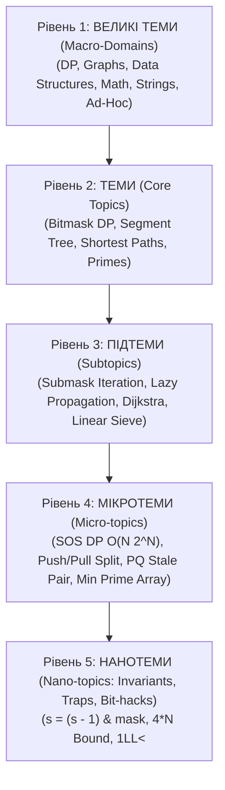

# 🌌 5-Рівнева Ультра-Декомпозиція Олімпіадного Матеріалу

> **Мета:** Повний перехід від хаотичного заучування коду до математично вивіреної ієрархії знань — від макро-доменів до нано-інваріантів та процесорних трюків.

---

## 🏛️ Ієрархія Рівнів

---

## 🔬 Анатомія Нано-Рівня (Level 5)

Кожна нано-одиниця знань має 4 обов'язкові атрибути:

1. **Атомарний інсайт (The Core Insight):** Формула або спостереження, яке перетворює задачу з нерозв'язної на тривіальну.
2. **Інваріант стану (Mathematical Invariant):** Твердження, яке лишається істинним на кожному кроці циклу або рекурсії.
3. **Олімпіадні граблі (Contest Trap / WA / TLE):** Типова помилка, на якій 90% учасників втрачають бали (переповнення 32-біт, `double` precision loss, UB, зациклення).
4. **Контестний ідіоматичний код (Bulletproof Code Snippet):** 2-5 рядків еталонного коду на C++/Python без зайвих бібліотек.

---

## 📋 Таблиця 5-Рівневого Розподілу (Приклади)

| Рівень 1 (Макро) | Рівень 2 (Тема) | Рівень 3 (Підтема) | Рівень 4 (Мікро) | Рівень 5 (Нано-інваріант & Граблі) |
| :--- | :--- | :--- | :--- | :--- |
| **DP** | Bitmask DP | Перебір підмасок | `O(3^N)` субітерація | `s = (s - 1) & mask` (не зациклитись на `s == 0`) |
| **DP** | Bitmask DP | Sum over Subsets | SOS DP `O(N · 2^N)` | Зовнішній цикл по бітах `i`, внутрішній по масці `mask` |
| **DP** | Tree DP | Rerooting | Двопрохідний DFS | Префіксні/суфіксні виключення для незворотних операцій (`max/gcd`) |
| **DP** | Оптимізації | Convex Hull Trick | Стек прямих `O(N)` | `(b3 - b1)*(k1 - k2) <= (b2 - b1)*(k1 - k3)` через `__int128` |
| **Data Structures** | Segment Tree | Lazy Propagation | `push()` / `pull()` | Чітке скидання lazy перед query; розмір масиву строго `4 * N` |
| **Data Structures** | Segment Tree | Персистентність | K-та статистика | `count(root[R]) - count(root[L-1])`; корені `roots[0]` з петлями |
| **Data Structures** | DSU | Відкати (Rollback) | Стек операцій | Заборона стиснення шляху `parent[x] = find(...)` при відкатах |
| **Graphs** | Найкоротші шляхи| Dijkstra | Оптимізація `priority_queue` | Фільтр застарілих пар: `if (d > dist[u]) continue;` та `long long` |
| **Graphs** | Найкоротші шляхи| 0-1 BFS | `std::deque` | `push_front` для 0, `push_back` для 1 (інваріант різниці $\le 1$) |
| **Graphs** | Зв'язність | Tarjan Bridges | `tin` та `low` | Строга нерівність моста: `low[to] > tin[u]`; ігнор ребра до батька |
| **Math** | Прості числа | Лінійне решето | `lp[i]` (min prime) | Умова лінійності: `if (i % p == 0) break;` |
| **Math** | Комбінаторика | $C(n, k) \pmod{MOD}$ | $O(N)$ факторіали | `inv_fact[i-1] = inv_fact[i] * i % MOD` у зворотному напрямку |
| **Strings** | Хешування | Rolling Hash | Подвійний хеш | База через `chrono::steady_clock`; заборона `unsigned long long` $2^{64}$ |
| **Foundations** | Пошук | Binary Search | Пошук по відповіді | `mid = low + (high - low)/2`; запобігання зацикленню при `R - L == 1` |
| **Contest Craft** | Тактика | Стрес-тести | Генератори дерев | Бамбук проти зірки (перевірка Stack Overflow при глибокому DFS) |
| **Contest Craft** | Граблі | Анти-Overflow | Аудит бітів | `1LL << k` замість `1 << k`; швидке введення без `std::endl` |
