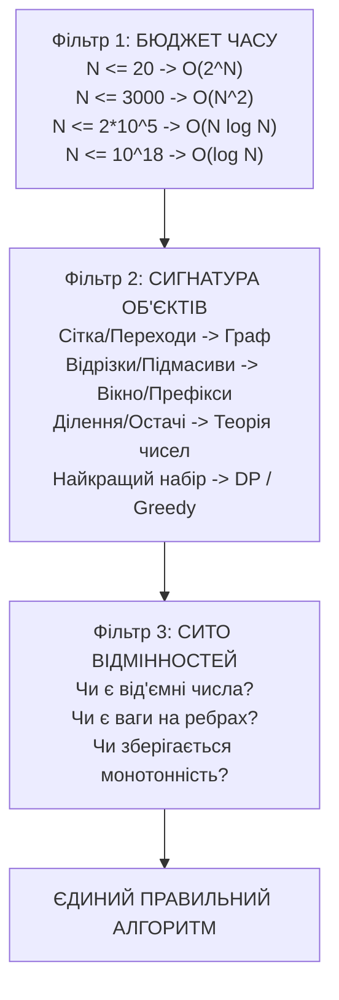

# 🏆 Енциклопедія Олімпіадного Програмування: Чому Це Легко, Дерево Навичок та Повний Розбір Пробного Туру

> **Мета посібника:** Довести, що олімпіадне програмування (ICPC / IOI) — це не «магія для обраних», а передбачуваний інженерний конструктор із чітких шаблонів мислення.  
> Ви навчитеся за 30 секунд бачити суть будь-якої задачі, відсікати хибні підходи та писати код без багів.

---

## 🧭 Зміст
1. [Маніфест: Чому Олімпіадне Програмування — це Конструктор LEGO](#1-маніфест-чому-олімпіадне-програмування--це-конструктор-lego)
2. [Як Працює Дерево Прийняття Рішень](#2-як-працює-дерево-прийняття-рішень)
3. [8 Фундаментальних Алгоритмічних Архетипів](#3-8-фундаментальних-алгоритмічних-архетипів)
   - [Архетип 1: Графи та Хвилі (BFS, 0-1 BFS, Дейкстра)](#архетип-1-графи-та-хвилі)
   - [Архетип 2: Два Вказівники та Ковзне Вікно](#архетип-2-два-вказівники-та-ковзне-вікно)
   - [Архетип 3: Бінарний Пошук (по масиву та по відповіді)](#архетип-3-бінарний-пошук)
   - [Архетип 4: Дерева та Топологічний Порядок](#архетип-4-дерева-та-топологічний-порядок)
   - [Архетип 5: Динамічне Програмування (DP)](#архетип-5-динамічне-програмування-dp)
   - [Архетип 6: Математика, Теорія Чисел та Інваріанти](#архетип-6-математика-теорія-чисел-та-інваріанти)
   - [Архетип 7: Мережеві Потоки та MCMF на DAG](#архетип-7-мережеві-потоки-та-min-cost-max-flow-mcmf)
   - [Архетип 8: Бордери Рядків та Алгоритми на Префіксах](#архетип-8-бордери-рядків-та-алгоритми-на-префіксах)
4. [Детальний Педагогічний Розбір Пробного Туру (UCPC 2026 Practice)](#4-детальний-розбір-пробного-туру-ucpc-2026-practice)
   - [Задача 1: A + B (Розминка, 64 біти)](#задача-1-a--b-warmup)
   - [Задача 2: Парність Рядків (Бітові маски, Паліндроми)](#задача-2-парність-рядків-parity-strings)
   - [Задача 3: Ковзне Вікно K (Subarray Sums)](#задача-3-ковзне-вікно-k-subarray-sums)
   - [Задача 4: Втеча з Лабіринту (Grid BFS) — https://ucpc.eolymp.space/.../problem/4](#задача-4-втеча-з-лабіринту-grid-bfs)
5. [Детальні Педагогічні Розбори Всіх 14 Задач I Етапу («Для Чайників»)](#5-детальні-педагогічні-розбори-всіх-14-задач-i-етапу-для-чайників)
6. [Чек-лист Анти-Граблів (Top-10 Помилок Олімпіадника)](#6-чек-лист-анти-граблів-top-10-помилок-олімпіадника)

---

## 1. Маніфест: Чому Олімпіадне Програмування — це Конструктор LEGO

Головний бар'єр новачка — страх: *«Тут складні умови, я ніколи не додумаюся до цього алгоритму»*.

### Правда полягає в тому, що:
1. **Автори задач не вигадують нові закони фізики.** Будь-яка задача контесту спирається на одну з 15 класичних ідей, замасковану під легенду (про бактерії, літаки, комп'ютери чи гірлянди).
2. **Складність алгоритму строго диктується лімітами.** Поглянувши на $N$, ви **ще до читання умови** знаєте допустиму асимптотику $O(...)$!
3. **Дерево рішень звужує вибір до 1-2 варіантів.** Якщо граф без ваг — це **тільки BFS**. Якщо масив монотонний — це **тільки Binary Search або Two Pointers**. Інших варіантів просто не існує в природі!

---

## 2. Як Працює Дерево Прийняття Рішень

Перед кодуванням ми пропускаємо задачу через **Сито 3 Фільтрів**:



* Повна інтерактивна схема доступна у [docs/ALGORITHM_DECISION_TREE.md](file:///C:/project/super-algo/docs/ALGORITHM_DECISION_TREE.md).
* 5-рівнева ієрархія знань: [docs/CP_5LEVEL_DECOMPOSITION.md](file:///C:/project/super-algo/docs/CP_5LEVEL_DECOMPOSITION.md).

---

## 3. 8 Фундаментальних Алгоритмічних Архетипів

---

### Архетип 1: Графи та Хвилі

#### 1. Як ідентифікувати:
- **Слова-маркери:** «лабіринт», «найменша кількість кроків/пересадок», «карта клітинок», «зв'язати вузли», «поширюється вірус/вогонь за хвилину».
- **Об'єкти:** Стан (координати $r, c$, вершина, конфігурація) та дозволені переходи між ними.

#### 2. Бюджет складності:
- $V \le 10^6, E \le 4 \cdot 10^6 \implies O(V + E)$ (лінійний час).

#### 3. Сито відмінностей: Чому саме цей алгоритм?

| Алгоритм | Ваги ребер | Структура даних | Складність | Коли обирати |
| :--- | :--- | :--- | :--- | :--- |
| **BFS** | Всі ребра $= 1$ (або без ваг) | `std::queue` / `deque` | $O(V + E)$ | Лабіринти, кроки гри, шахівниця, хвиля зараження |
| **0-1 BFS** | Ваги тільки $0$ і $1$ | `std::deque` | $O(V + E)$ | Перехід безкоштовний або коштує 1 (поворот, телепорт) |
| **Dijkstra** | Будь-які додатні ваги $w \ge 0$ | `std::priority_queue` | $O(E \log V)$ | Дороги різної довжини, час польоту |
| **Floyd-Warshall** | Усі пари $(u, v)$, $V \le 500$ | 3 вкладені цикли | $O(V^3)$ | Коли потрібні найкоротші шляхи між ВСІМА парами |

#### 4. Часті помилки (Граблі):
- ❌ **Запуск DFS для пошуку найкоротшого шляху:** DFS знаходить *якийсь* шлях, а не найкоротший! Спроба обійти всі шляхи дає експоненційний $O(4^{V}) \implies$ TLE та стек-оверфлоу.
- ❌ **Позначення `visited` при вийманні з черги, а не при додаванні:** призводить до додавання однієї вершини в чергу сотні разів $\implies$ Memory Limit Exceeded!

#### 5. Що можна змінювати (Варіації):
- **Розмірність:** від 2D сітки $(r, c)$ до 3D $(r, c, z)$ чи стану з ключами $(r, c, \text{mask})$.
- **Багатоджерельний BFS (Multi-source BFS):** вогонь горить у 5 місцях одночасно — просто кладемо всі 5 точок у чергу на старті з відстанню 0!

---

### Архетип 2: Два Вказівники та Ковзне Вікно

#### 1. Як ідентифікувати:
- **Слова-маркери:** «підмасив довжини $K$», «сума $\le M$», «найдовший відрізок з не більше ніж $C$ різними елементами», «знайти пару $a_i + a_j$».
- **Об'єкти:** Відрізок масиву $[L, R]$, який розширюється або стискається.

#### 2. Бюджет складності:
- $N \le 10^7 \implies O(N)$ лінійний час. Обидва вказівники рухаються тільки вперед!

#### 3. Сито відмінностей:

| Ситуація | Інструмент | Чому не інший? |
| :--- | :--- | :--- |
| Довжина вікна **фіксована** ($K$) | **Ковзне вікно (Sliding Window)** | Вікно просто зсувається: віднімаємо старий елемент, додаємо новий за $O(1)$. |
| Довжина вікна **змінна**, умова монотонна | **Два вказівники (Two Pointers)** | При збільшенні $R$ сума зростає; щоб зменшити — рухаємо $L$. |
| Масив містить **від'ємні числа** | **Префіксні суми + Хеш-таблиця** | Монотонність зникає! Два вказівники ламаються, допомагає лише префіксна сума. |

#### 4. Часті помилки (Граблі):
- ❌ **Забули оновити стан при зсуві $L$:** видалили елемент з індексу, але не зменшили лічильник у частотній таблиці.
- ❌ **Вихід $R$ або $L$ за межі масиву (Off-by-one error).**

---

### Архетип 3: Бінарний Пошук

#### 1. Як ідентифікувати:
- **Слова-маркери:** «знайти елемент у відсортованому масиві», «мінімізувати максимальне значення», «максимальна швидкість, при якій встигнемо».
- **Головна передумова:** Функція валідності **монотонна**:
  $$\text{check}(x): [\text{False, False, \dots, False, True, True, True}]$$

#### 2. Бюджет складності:
- $O(N \log(\text{MAX}))$ операцій. При $\text{MAX} = 10^{18}$ робиться лише $\approx 60$ перевірок!

#### 3. Сито відмінностей:
- Якщо масив відсортований і питають позицію $\implies$ `std::lower_bound` / `std::upper_bound` ($O(\log N)$).
- Якщо треба оптимізувати величину, і легко перевірити «чи підходить число $X$» за $O(N)$ $\implies$ **Binary Search по відповіді**.

#### 4. Часті помилки (Граблі):
- ❌ **Переповнення при обчисленні середини:** `(L + R) / 2` переповнює 32-бітний `int`, якщо $L+R > 2 \cdot 10^9$. **Пишіть:** `L + (R - L) / 2`.
- ❌ **Нескінченний цикл при $R - L = 1$:** невідповідність між `L = mid` та формулою обчислення `mid` призводить до зависання.

---

### Архетип 4: Дерева та Топологічний Порядок

#### 1. Як ідентифікувати:
- **Слова-маркери:** «$N$ вершин і $N-1$ ребер», «немає циклів», «ієрархія підлеглих», «папки та підпапки», «умова $a_v < v$».

#### 2. Магічна властивість $a_v < v$:
- Якщо батько папки завжди має менший номер, ніж дитина ($a_v < v$), дерево **вже топологічно впорядковане**!
- Не потрібні DFS, рекурсія чи граф. Достатньо одного циклу `for (int v = 1; v <= n; ++v)`! (Саме це було ключем у [Задачі A: Антивірус](file:///C:/project/super-algo/tasks/ucpc2026_stage1/problem_A_antivirus/README.md)).

#### 3. Сито відмінностей:
- Шлях між двома вершинами $u$ і $v$ на статичному дереві $\implies$ **LCA через Binary Lifting** ($O(\log N)$).
- Динаміка знизу-вгору $\implies$ **Tree DP** ($O(N)$).

---

### Архетип 5: Динамічне Програмування (DP)

#### 1. Як ідентифікувати:
- **Слова-маркери:** «знайти кількість способів», «найбільша вартість рюкзака», «розбити на найменшу кількість груп», «чи можна набрати суму».
- **Головна суть:** Відповідь для задачі розміру $N$ виражається через відповіді для менших підзадач.

#### 2. Бюджет складності:
- $N \le 20 \implies$ **Bitmask DP** ($O(2^N \cdot N)$).
- $N \le 500 \implies$ **Interval DP / 3D DP** ($O(N^3)$).
- $N \le 5000 \implies$ **2D DP** ($O(N^2)$).
- $N \le 2 \cdot 10^5 \implies$ **1D DP з оптимізаціями (ДО, CHT)** ($O(N \log N)$).

---

### Архетип 6: Математика, Теорія Чисел та Інваріанти

#### 1. Як ідентифікувати:
- **Слова-маркери:** «остача від ділення», «число ділиться на суму своїх цифр», «$\gcd(a, b)$», «гра двох гравців», «$N \le 10^{18}$».

#### 2. Секрет успіху:
- Якщо $N = 10^{18}$, то цикл неможливий. Треба взяти аркуш паперу, виписати перші 5 значень і знайти **математичний інваріант** або циклічність за модулем.
- Приклади з I етапу:
  - [Задача C: Танок залишків](file:///C:/project/super-algo/tasks/ucpc2026_stage1/problem_C_dance_of_remainders/README.md): нерівність $a \ge b \ge c \ge a \implies a=b=c \implies \min(n, m, k)$ за $O(1)$!
  - [Задача B: Колекційні пари](file:///C:/project/super-algo/tasks/ucpc2026_stage1/problem_B_collectible_pairs/README.md): конструкція $x = c \cdot 10^B$ із сумою цифр 8.
  - [Задача K: Сума і добуток](file:///C:/project/super-algo/tasks/ucpc2026_stage1/problem_K_sum_and_product/README.md): корені Вієта для 1, 2 або 3 чисел.

---

### Архетип 7: Мережеві Потоки та Min-Cost Max-Flow (MCMF)

#### 1. Як ідентифікувати:
- **Слова-маркери:** «розподілити задачі між $K$ комп'ютерами/працівниками», «максимальна сумарна вартість без перетинів», «пропускна здатність каналів».
- **Головна суть:** Жодна проста жадібність не знаходить глобального оптимуму, оскільки вибір однієї задачі блокує ресурс для інших.
- **Модель MCMF на DAG:**
  - Будуємо вісь часу: ребра простою мають ємність $K$ (кількість машин) і вартість $0$.
  - Кожна задача — альтернативне ребро ємності $1$ і вартості $-w_i$.
  - Пускаємо рівно $K$ одиниць потоку. На ациклічному графі (DAG) потенціали Джонсона обчислюються за лінійний час, а $K$ запусків Дейкстри знаходять оптимум за $O(K \cdot N \log N)$! (Див. [Задача L: Три комп'ютери](file:///C:/project/super-algo/tasks/ucpc2026_stage1/problem_L_three_computers/README.md)).

---

### Архетип 8: Бордери Рядків та Алгоритми на Префіксах

#### 1. Як ідентифікувати:
- **Слова-маркери:** «бордер слова», «префікс-функція КМП», «рядки без самоперетинів», «період рядка».
- **Визначення:** Бордер — це підрядок, який одночасно є власним префіксом і суфіксом слова.
- **Секрет лінійного ДП:** Замість перебору дільників за $O(N^2)$, віднімання рівностей для $n$ та $n-1$ взаємно скорочує всі члени, окрім центрального $u(m)$! Рекурентність $u(2m) = k \cdot u(2m-1) - u(m) \pmod{10^9+7}$ рахується за $O(N)$! (Див. [Задача H: Візерунок](file:///C:/project/super-algo/tasks/ucpc2026_stage1/problem_H_pattern/README.md)).

---

## 4. Детальний Розбір Пробного Туру (UCPC 2026 Practice)

Пробний тур складається з 4 класичних задач, які демонструють фундаментальні навички олімпіадника.

---

### Задача 1: A + B (Warmup)
- **Посилання на розбір:** [tasks/ucpc2026_practice/problem_1_sum_ab/README.md](file:///C:/project/super-algo/tasks/ucpc2026_practice/problem_1_sum_ab/README.md)
- **Тема у дереві:** *4. Числа та арифметика $\to$ Введення-виведення та 64-бітний діапазон.*
- **Суть:** Просте додавання двох цілих чисел у діапазоні $[-10^{18}, 10^{18}]$.
- **Чому це важливо на ICPC:** 80% невдалих стартів стаються через те, що команда написала `int` замість `long long` у C++, отримала переповнення (Overflow) і штрафні 20 хвилин.
- **Еталонний код:**
  ```cpp
  #include <iostream>
  using namespace std;
  int main() {
      ios_base::sync_with_stdio(false);
      cin.tie(nullptr);
      long long a, b;
      if (cin >> a >> b) cout << a + b << "\n";
      return 0;
  }
  ```

---

### Задача 2: Парність Рядків (Parity Strings)
- **Посилання на розбір:** [tasks/ucpc2026_practice/problem_2_parity_strings/README.md](file:///C:/project/super-algo/tasks/ucpc2026_practice/problem_2_parity_strings/README.md)
- **Тема у дереві:** *5. Рядки $\to$ Паліндроми $\to$ Бітові маски парності (Bitmask Parity).*
- **Суть:** Чи можна переставити літери рядка так, щоб утворився паліндром?
- **Інваріант паліндрома:** У паліндромі **щонайбільше одна літера** може зустрічатися непарну кількість разів!
- **Елегантний трюк з бітами:** Зберігаємо стан 26 літер у 32-бітному цілому числі `mask`:
  $$\text{mask} \leftarrow \text{mask} \oplus (1 \ll (c - 'a'))$$
  Перевірка, чи не більше однієї одиниці: `(mask & (mask - 1)) == 0`! Складність $O(|S|)$ часу та $O(1)$ пам'яті.

---

### Задача 3: Ковзне Вікно K (Subarray Sums)
- **Посилання на розбір:** [tasks/ucpc2026_practice/problem_3_subarray_sums/README.md](file:///C:/project/super-algo/tasks/ucpc2026_practice/problem_3_subarray_sums/README.md)
- **Тема у дереві:** *1. Робота з відрізками $\to$ Ковзне вікно фіксованого розміру (Sliding Window).*
- **Суть:** Знайти максимальну суму підмасиву довжини рівно $K$ у масиві з $N$ чисел.
- **Чому наївний падає:** Рахувати суму кожного відрізка вкладеним циклом — це $O(N \cdot K) \approx 10^{10} \implies$ TLE.
- **Оптимально:** Зсув вікна за $O(1)$:
  $$\text{Sum}_{\text{new}} = \text{Sum}_{\text{old}} - A[i - K] + A[i]$$
  Загальна складність $O(N)$!

---

### Задача 4: Втеча з Лабіринту (Grid BFS)
- **Офіційне посилання на контест:** [https://ucpc.eolymp.space/uk/compete/ucpc2026practice/problem/4](https://ucpc.eolymp.space/uk/compete/ucpc2026practice/problem/4)
- **Посилання на розбір:** [tasks/ucpc2026_practice/problem_4_grid_escape/README.md](file:///C:/project/super-algo/tasks/ucpc2026_practice/problem_4_grid_escape/README.md)
- **Тема у дереві:** *3. Графи $\to$ Найкоротший шлях $\to$ Всі ребра ваги 1 $\implies$ Grid BFS.*
- **Складність:** Medium.

#### 1. Вдупляння (Sense-Making):
Дано прямокутну сітку $N \times M$.
- `'S'` — старт;
- `'E'` — вихід;
- `'.'` — прохідний коридор;
- `'#'` — непрохідна стіна.
За 1 крок можна переміститися в 4 сусідні клітинки: вгору, вниз, вліво, вправо. Знайти **мінімальну кількість кроків** від `'S'` до `'E'` або вивести `-1`, якщо виходу заблоковано.

#### 2. Чому сітка — це граф?
- Кожна вільна клітинка $(r, c)$ — це **вершина**.
- Перехід між сусідніми не-стінами — це **неорієнтоване ребро ваги 1**.
- Загалом вершин: $V = N \cdot M \le 10^6$. Ребер: $E \le 4 \cdot 10^6$.

#### 3. Чому САМЕ BFS, а не DFS?
- **DFS:** піде вглиб по першому-ліпшому коридору, може зробити $10^6$ кроків у глухий кут і повернеться назад. Щоб знайти мінімум, DFS мусить перебрати всі шляхи $O(4^{NM})$ — це повний крах по часу (`TLE`) та переповнення стеку (`SIGSEGV`).
- **BFS (Breadth-First Search):** розширює хвилю кола радіусами $d = 0, 1, 2, \dots$. Коли хвиля **вперше** торкається виходу `'E'`, це математично гарантовано найкоротший шлях!

#### 4. Математичний інваріант черги BFS:
У черзі `std::queue` / `collections.deque` відстані завжди монотонні:
$$\text{dist}[\text{tail}] - \text{dist}[\text{head}] \le 1$$
Це означає, що ми обробляємо всі вершини відстані $d$ строго до того, як почнемо обробляти вершини відстані $d+1$.

#### 5. Еталонний код на C++20:
```cpp
#include <bits/stdc++.h>
using namespace std;

const int dr[] = {-1, 1, 0, 0};
const int dc[] = {0, 0, -1, 1};

int main() {
    ios_base::sync_with_stdio(false);
    cin.tie(NULL);

    int n, m;
    if (!(cin >> n >> m)) return 0;

    vector<string> grid(n);
    int start_r = -1, start_c = -1;
    int exit_r = -1, exit_c = -1;

    for (int r = 0; r < n; ++r) {
        cin >> grid[r];
        for (int c = 0; c < m; ++c) {
            if (grid[r][c] == 'S') { start_r = r; start_c = c; }
            if (grid[r][c] == 'E') { exit_r = r; exit_c = c; }
        }
    }

    vector<vector<int>> dist(n, vector<int>(m, -1));
    queue<pair<int, int>> q;

    dist[start_r][start_c] = 0;
    q.push({start_r, start_c});

    while (!q.empty()) {
        auto [r, c] = q.front();
        q.pop();

        if (r == exit_r && c == exit_c) {
            cout << dist[r][c] << "\n";
            return 0;
        }

        for (int i = 0; i < 4; ++i) {
            int nr = r + dr[i];
            int nc = c + dc[i];

            if (nr >= 0 && nr < n && nc >= 0 && nc < m && grid[nr][nc] != '#') {
                if (dist[nr][nc] == -1) {
                    dist[nr][nc] = dist[r][c] + 1;
                    q.push({nr, nc});
                }
            }
        }
    }

    cout << -1 << "\n";
    return 0;
}
```

---

## 5. Детальні Педагогічні Розбори Всіх 14 Задач I Етапу («Для Чайників»)

Кожна задача I етапу має свій чіткий шаблон мислення. Ось як бачити розв'язок за лічені хвилини:

---

### Задача A: Антивірус (Antivirus) — Дерева та Топологічний Порядок
- **Суть на пальцях:** Уявіть дерево папок. Кожна папка лежить всередині якоїсь іншої ($a_v < v$). Ми запускаємо сканування з папки $c_j$ з силою $d_j$. Сила означає, на скільки рівнів підпапок пройде сигнал. Скільки всього унікальних папок перевіриться?
- **Чому наївний падає:** Запускати BFS/DFS окремо для кожного з $K$ антивірусів — це $O(N \cdot K) \approx 2 \cdot 10^5 \times 2 \cdot 10^5 = 4 \cdot 10^{10}$ операцій $\implies$ безнадійне `TLE`.
- **Момент ЕВРИКА:** Умова $a_v < v$ означає, що батько ЗАВЖДИ має менший номер, ніж дитина! Дерево вже топологічно відсортоване. Достатньо одного звичайного циклу `for v in range(1, n+1)`:
  $$b[v] = \max(b[v], b[parent] - 1)$$
  Сила стікає від батьків до дітей за один прохід за $O(N + K)$! Не потрібні жодні графічні структури чи рекурсія.

---

### Задача B: Колекційні пари (Collectible Pairs) — Математичний Конструктив
- **Суть на пальцях:** Число називається красивим (числом Нівена/Харшада), якщо воно ділиться на суму своїх цифр. Треба знайти пару сусідніх гарних чисел $(x, x+1)$ у діапазоні $[m, 2m]$.
- **Чому наївний падає:** Перебирати числа в циклі від $m$ до $2m$ неможливо, коли $m \le 10^{18}$! Цикл триватиме сотні років $\implies$ `TLE`.
- **Момент ЕВРИКА:** Сконструювати числа аналітично!
  - Число $x = c \cdot 10^B$ має суму цифр 8, якщо $\text{sum}(c) = 8$. Оскільки $10^B$ ділиться на 8 при $B \ge 3$, то $x$ автоматично ділиться на 8!
  - Сусіднє число $x + 1$ закінчується на 1, тому його сума цифр $8 + 1 = 9$. А отже воно ділиться на 9!
  - Префікси $c \in \{17, 26, 35, 62, 107\}$ повністю покривають будь-який відрізок $[m, 2m]$. Розв'язок за $O(|m|)$ у 5 рядків!

---

### Задача C: Танок залишків (Dance of Remainders) — Теорія Чисел та Інваріант
- **Суть на пальцях:** Маємо три числа: $1 \le a \le N$, $1 \le b \le M$, $1 \le c \le K$. Вимагається, щоб $a \pmod b = b \pmod c = c \pmod a$. Скільки таких трійок існує?
- **Чому наївний падає:** Три вкладені цикли `for a in range... for b in range...` дають $O(N \cdot M \cdot K) \approx 10^{15} \implies$ `TLE`.
- **Момент ЕВРИКА:** Нехай спільний залишок дорівнює $r$.
  - За визначенням остачі, $a > r$, $b > r$, $c > r$.
  - Якщо $a < b$, то $a \pmod b = a$, отже $r = a$. Але $r < a$ — суперечність!
  - Тому неминуче $a \ge b \ge c \ge a \implies a = b = c$!
  - Єдиний можливий залишок — це $0$. А рівні числа можуть бути лише від $1$ до $\min(N, M, K)$. Відповідь: `min({n, m, k})` за $O(1)$!

---

### Задача D: Парні та непарні (Evens and Odds) — Жадібний Баланс Парності
- **Суть на пальцях:** Дописати до числа $N$ мінімальний хвіст цифр справа, щоб сума непарних цифр на парних позиціях дорівнювала сумі парних цифр на непарних позиціях.
- **Чому наївний падає:** Перебір усіх можливих дописуваних чисел перебором $10^k$ вибухає миттєво.
- **Момент ЕВРИКА:** Обчислимо початковий дисбаланс $\Delta$. Перебираємо довжину хвоста $k = 1, 2, 3 \dots$. Для кожного $k$ математична формула діапазону $[low, high]$ за $O(1)$ визначає, чи можливо досягти балансу цими розрядами. Як тільки довжину знайдено — жадібно підбираємо найменшу можливу цифру від $0$ до $9$ для кожного розряду зліва направо!

---

### Задача E: Чотири числа (Four Numbers) — Meet-in-the-Middle + Два Вказівники
- **Суть на пальцях:** Обрати 4 числа з масиву (можна однакові), щоб їхня сума була максимальною, але не перевищувала ліміт $M$.
- **Чому наївний падає:** 4 вкладені цикли — це $O(N^4) \approx (2000)^4 = 1.6 \cdot 10^{13} \implies$ `TLE`.
- **Момент ЕВРИКА:** Розбиваємо вибір 4 елементів на 2 + 2 (Meet-in-the-Middle)!
  1. Генеруємо всі попарні суми $P_{i,j} = a_i + a_j$. Їх усього $S \approx \frac{N^2}{2} \approx 2 \cdot 10^6$.
  2. Сортуємо їх за $O(S \log S)$.
  3. Задача звелася до пошуку $P_L + P_R \le M$. Використовуємо класичні **Два вказівники**: $L$ зліва, $R$ справа. Час роботи $O(N^2 \log N)$!

---

### Задача F: Переплутані покази (Confused Readings) — Мін-Купа та Мультимножина
- **Суть на пальцях:** Прилад записав $2(2^n - 1)$ показів: для кожної підмножини невідомого масиву $a$ він записав суму та побітове АБО (OR). Треба відновити початковий масив $a$.
- **Чому наївний падає:** Перебір підмножин для $2n$ елементів факторіально великий.
- **Момент ЕВРИКА:** Сортуємо всі покази.
  - Найменше додатне число в журналі — це гарантовано перший елемент $a_1$!
  - Знаючи $a_1$, ми знаємо покази підмножин з нього (сума $a_1$, OR $a_1$). Кладемо їх у мін-купу (`std::priority_queue`).
  - Йдемо по журналу далі: якщо поточний показ збігається з вершиною купи — це вже пояснена підмножина, вилучаємо її. Якщо показу немає в купі — це наступний елемент $a_{k+1}$! Потім додаємо всі комбінації $a_{k+1}$ зі старими підмножинами в купу. Складність $O(2^n \cdot n)$!

---

### Задача G: Числова гра (Number Game) — Бітові Інваріанти Popcount
- **Суть на пальцях:** За один крок можна переставити біти числа $x$ (зберігши кількість одиниць $\text{popcount}$) та замінити $x \to x + 1$. Знайти мінімум кроків від двійкового рядка $n$ до $m$.
- **Чому наївний падає:** Простір станів двійкових чисел довжини $10^5$ гігантський — пошук у ширину (BFS) захлинеться.
- **Момент ЕВРИКА:** Додавання $1$ до блока з $k$ одиниць ($...0111 \to ...1000$) скидає кількість одиничок! Тому за 1 крок можна отримати будь-який popcount, менший або рівний $c + 1$.
  - Число $m$ досягається лише з $m-1$, у якого $p = \text{popcount}(m-1)$.
  - Якщо $c = p \implies 1$ хід; якщо $c > p \implies 2$ ходи; якщо $c < p \implies p - c + 1$ ходів. Обчислюється за $O(|n| + |m|)$!

---

### Задача H: Візерунок (Pattern) — Бордери Слів та Лінійна Динаміка
- **Суть на пальцях:** Знайти кількість рядків довжини $n$ над алфавітом розміру $k$, які не мають бордерів (жоден непорожній префікс не є суфіксом).
- **Чому наївний падає:** Перевірка бордерів за формулою включень-виключень через усі дільники займає $O(n^2)$, що дає TLE при $n = 5000$.
- **Момент ЕВРИКА:** Якщо записати рівняння для довжини $n$ та $n-1$, майже всі доданки взаємно скорочуються!
  - $u(1) = k$;
  - $u(2m+1) = k \cdot u(2m)$;
  - $u(2m) = k \cdot u(2m-1) - u(m) \pmod{10^9 + 7}$.
  Завдяки скороченню задача розв'язується одним простим циклом за $O(n)$!

---

### Задача I: Круглий стіл (Round Table) — Подвоєння Кола 2N та Двійкові Підйоми
- **Суть на пальцях:** $n$ студентів сидять за круглим столом. Є $m$ пар друзів (дуг). Треба обрати найбільшу кількість дуг, які не перетинаються.
- **Чому наївний падає:** Запускати жадібний вибір для кожної з $n$ точок столу — це $O(n \cdot m) \approx 2 \cdot 10^5 \times 2 \cdot 10^5 = 4 \cdot 10^{10} \implies$ `TLE`.
- **Момент ЕВРИКА:**
  1. Розгортаємо коло у подвійний відрізок $[1 \dots 2n]$. Дуга $[l, r]$ стає двома відрізками: $[l, r]$ та $[l+n, r+n]$.
  2. Будуємо масив переходів $nxt[0][v]$ — перший відрізок, що починається після кінця поточного.
  3. Будуємо таблицю двійкових підйомів $nxt[k][v]$ за $O(n \log n)$. Тепер для будь-якої початкової точки ми знаходимо максимальну кількість відрізків за $O(\log n)$! Разом $O(m + n \log n)$.

---

### Задача J: Терези (Scales) — Інтерактивна Оптимізація Запитів
- **Суть на пальцях:** Є два невідомих $n$-бітних числа $a$ і $b$. Ми можемо робити запити порівняння з масками: $(a \oplus x)$ та $(b \oplus y)$. Треба відгадати обидва числа не більше ніж за $2n$ запитів.
- **Чому наївний падає:** Звичайний побітовий пошук вимагає 2 запити на біт ($2n$ запитів), і найменший крайовий збій перевищує ліміт контесту.
- **Момент ЕВРИКА:** Підтримуємо співвідношення хвостів чисел $c \in \{<, =, >\}$.
  - Коли хвости рівні ($c = {=}$), обидва біти визначаються **рівно за 1 зважування**!
  - Останній біт $a_0, b_0$ взагалі визначається безкоштовно через накопичений інваріант. Разом виходить строго $\le 2n - 1$ запитів, що з запасом вкладається в ліміт!

---

### Задача K: Сума і добуток (Sum and Product) — Формули Вієта та Чисельна Стабільність
- **Суть на пальцях:** Знайти мінімальну кількість дійсних чисел $n$, сума яких дорівнює $s$, а добуток дорівнює 1.
- **Чому наївний падає:** Чисельні методи оптимізації (градієнтний спуск, тернарний пошук) не дають точних значень і падають на точності float.
- **Момент ЕВРИКА:** Відповідь завжди $n \in \{1, 2, 3\}$!
  - $n=1$: якщо $s = 1$.
  - $n=2$: шукаємо корені $t^2 - st + 1 = 0$. Дискримінант $D = s^2 - 4$. Якщо $|s| \ge 2$, корені дійсні!
  - $n=3$: якщо $|s| < 2$, фіксуємо $a_1 = -1$. Тоді добуток двох інших $-1$, а сума $s + 1$. Рівняння: $y^2 - (s+1)y - 1 = 0$, дискримінант $D = (s+1)^2 + 4 > 0$ — завжди строго додатний при будь-якому $s$! Відповідь за $O(1)$.

---

### Задача L: Три комп'ютери (Three Computers) — Потік Мін-Вартості на DAG
- **Суть на пальцях:** Розподілити відрізки задач між 3 комп'ютерами, щоб максимізувати сумарну вартість (бали) виконаних задач.
- **Чому наївний падає:** Жадібний алгоритм вибору задач за балами заходить у безвихідь, а перебір трьох станів динаміки дає $O(N^3)$.
- **Момент ЕВРИКА:** Представляємо задачу як Min-Cost Flow:
  - Вісь часу від 1 до $2N$: ребра простою мають пропускну здатність 3 і вартість 0.
  - Кожна задача — це альтернативне ребро від $l_i$ до $r_i$ з ємністю 1 і вартістю $-w_i$.
  - Пускаємо 3 одиниці потоку від Джерела до Стоку. Оскільки граф ациклічний (DAG), потенціали вершин рахуються за лінійний час, а 3 фази Дейкстри знаходять ідеальний максимум за $O(N \log N)$!

---

### Задача M: Гірлянда UCPC (UCPC Garland) — Два Жадібні Проходи
- **Суть на пальцях:** Дано рядок літер. Шукаємо всі можливі входження підпослідовності «UCPC». Лампи, які не беруть участі в жодному входженні UCPC, є «вільними». Знайти кількість узгоджених розфарбувань.
- **Чому наївний падає:** Перебір усіх можливих комбінацій підпослідовностей має експоненційну складність $O(2^N)$.
- **Момент ЕВРИКА:**
  1. Жадібний прохід зліва $L$ знаходить **найраніші** позиції літер 'U', 'C', 'P', 'C'.
  2. Жадібний прохід справа $R$ знаходить **найпізніші** позиції.
  3. Будь-яка лампа з відповідною літерою між $L_j$ та $R_j$ є активною! Усі інші — вільні ($3^f$ варіантів).
  4. Якщо лампа може грати обидві ролі букви 'C' ($L_3 \le R_1$), їхні кольори збігаються $\implies 3^{f+3}$; інакше всі 4 букви незалежні $\implies 3^{f+4}$! Складність $O(N)$.

---

### Задача N: Щоденник погоди (Weather Diary) — Ейлерів Шлях у 2 Вершинах
- **Суть на пальцях:** Перевірити, чи існує послідовність днів з $u$ переходами $S \to R$, $v$ переходами $R \to S$, $e$ переходами $S \to S$ та $g$ переходами $R \to R$.
- **Чому наївний падає:** Моделювання перебором перестановок днів падає вже при $N = 10$.
- **Момент ЕВРИКА:** Граф має лише 2 вершини: Сонячно ($S$) та Дощ ($R$).
  - Кожен крок $S \to R$ вимагає повернення $R \to S$, щоб знову опинитися у стані $S$.
  - Тому умова Ейлерового ланцюга вимагає строго $|u - v| \le 1$ та $u + v + 1 + e + g = n$.
  - Якщо умова виконується, послідовність конструюється за 1 рядок: чергуємо $S$ і $R$, вклеюючи цикли $e$ та $g$ всередину! Перевірка за $O(1)$.

---

---

## 6. Чек-лист Анти-Граблів (Top-10 Помилок Олімпіадника)

Перед кожною відправкою розв'язку (Submit) перевірте себе за цим чек-листом:

1. 🛑 **Чи не переповнюється `int`?** Якщо сума, добуток або координати можуть перевищити $2 \cdot 10^9$ — пишіть `long long` у C++!
2. 🛑 **Чи є fast I/O?** Обов'язково додавайте `ios_base::sync_with_stdio(false); cin.tie(NULL);`.
3. 🛑 **Чи немає `std::endl`?** Використовуйте `\n`, бо `endl` викликає примусове скидання буфера і спричиняє `TLE`.
4. 🛑 **Чи опрацьовано $N = 1$ та порожні дані?** Крайовий випадок — головна причина 40% вердиктів `Wrong Answer`.
5. 🛑 **Чи може відповідь бути від'ємною або 0?** Не використовуйте `-1` або `0` як фіктивне значення-сторож, якщо вони є валідними результатами.
6. 🛑 **Чи немає зациклення бінарного пошуку?** Перевіряйте роботу на відрізку довжини 2 ($R - L = 1$).
7. 🛑 **Чи правильний модуль?** Додавайте `(x % MOD + MOD) % MOD` після віднімання, щоб уникнути від'ємних остач у C++.
8. 🛑 **Чи ініціалізовано масив `dist` значенням `-1`?** Початок зі значення 0 може заплутати старт та невідвідані вершини.
9. 🛑 **Чи не використовуються важкі структури там, де достатньо вектора?** `std::map` та `std::set` мають константу в 10-20 разів повільнішу за звичайний масив.
10. 🛑 **Чи перевірено ручні тести?** Завжди проженіть код на 2-3 крайніх тестах на чернетці перед кліком "Відправити".
