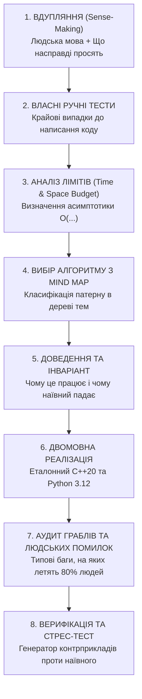

# 🎯 Олімпіадний Протокол Декомпозиції Задачі (The Master Problem Pipeline)

Цей протокол є обов'язковим стандартом розбору кожної задачі, яку надсилає користувач (із завданнями, контестами або "шпорами").

---

## 8 Етапів Обробки Будь-Якої Задачі

---

### Етап 1: Вдупляння (Sense-Making)
- **Суть:** Переклад задачі з громіздкої формуліровки на просту мову «для чайників».
- **Питання:**
  - Що є об'єктами? (Числа, вершини, інтервали, символи?)
  - Що дозволено робити за один крок?
  - Яку функцію треба мінімізувати / максимізувати або порахувати кількість способів?

### Етап 2: Ручні тести (Manual Corner Tests)
- Придумати **3 власні мінімальні тести**:
  1. *Тривіальний тест* ($N=1$ або порожній/мінімальний розмір).
  2. *Негативний/нульовий тест* (всі елементи однакові, від'ємні числа, граф-ланцюг).
  3. *Контр-приклад для наївного розуміння* (де інтуїтивне рішення ламається).

### Етап 3: Ліміти та бюджет часу (Complexity Budget)
У спортивному програмуванні процесор робить $\approx 10^8$ операцій за 1 секунду.

| Обмеження $N$ | Максимально допустима складність | Типові алгоритми |
| :--- | :--- | :--- |
| $N \le 10$ | $O(N!)$ або $O(N^2 \cdot 2^N)$ | Повний рекурсивний перебір, перестановок `next_permutation` |
| $N \le 20$ | $O(2^N \cdot N)$ | Bitmask DP, Meet-in-the-middle ($N \le 40$) |
| $N \le 500$ | $O(N^3)$ | Флойд-Воршелл, матричне множення, 3D DP |
| $N \le 5000$ | $O(N^2)$ | Вкладені цикли, 2D DP, прості графи |
| $N \le 2 \cdot 10^5$ | $O(N \log N)$ або $O(N \log^2 N)$ | Сортування, бінарний пошук, Дерево відрізків, Фенвік, Дейкстра, Set/Map |
| $N \le 10^7$ | $O(N)$ | Два вказівники, ковзне вікно, префіксні суми, лінійне решето |
| $N \le 10^{18}$ | $O(\log N)$ або $O(1)$ | Бінарне піднесення до степеня, Матричне швидке множення, Формули |

### Етап 4: Вибір з ієрархічної карти алгоритмів (Algorithm Selector)
- Знайти місце задачі у **Глобальному Mind Map**:
  - Масив монотонний? $\implies$ Двійковий пошук або Два вказівники.
  - Потрібні найкоротші шляхи без від'ємних ребер? $\implies$ Дейкстра.
  - Ваги ребер лише 0 і 1? $\implies$ 0-1 BFS на деці.
  - Запити модифікації та суми на відрізку? $\implies$ Дерево Фенвіка або Segment Tree.
  - Знайти кількість розбиттів числа або масок? $\implies$ Динамічне Програмування.

### Етап 5: Доведення та Інваріант
- Чому наївний варіант (Brute Force) робить зайву роботу?
- Який інваріант зберігається на кожному кроці?

### Етап 6: Еталонний код (C++20 та Python 3.12)
- **C++:** Максимальна швидкість, fast I/O, уникнення overhead, типізація `long long`.
- **Python:** Чистий синтаксис, швидке читання `sys.stdin.readline`, модуль `sys.setrecursionlimit`.

### Етап 7: Аудит людських помилок (Catalog of Human Bugs)
- ❌ **Забутий `1LL`:** `(1 << 35)` замість `(1LL << 35)` $\implies$ UB.
- ❌ **Overflow у множенні:** `a * b` перед modulo переповнює `int32` $\implies$ потрібен каст до `1LL * a * b`.
- ❌ **Зависання Binary Search:** `mid = (low + high) / 2` замість `low + (high - low) / 2` та зациклення при $R - L = 1$.
- ❌ **Використання `std::endl`:** викликає скидання буфера і призводить до TLE.
- ❌ **Індексація 0-based vs 1-based:** зсув на одиницю при роботі з деревом Фенвіка або графами.

### Етап 8: Стрес-тест (Fuzzing)
- Написання 5-рядкового наївного повільного розв'язку.
- Запуск рандомайзера на 1000 тестів через `scripts/stress_tester.py`.
- Видача точного мінімального контрприкладу.
