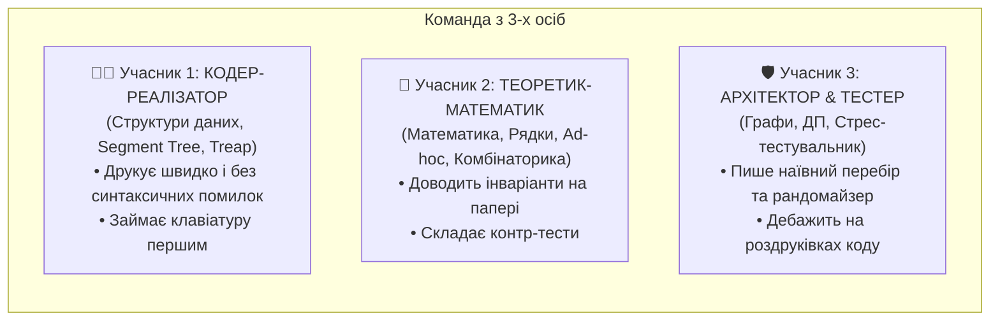

# ⚔️ Тактичний Мануал Команди ICPC / IOI: Як Вийти в ТОП

> **Головне правило ICPC (1 комп'ютер на 3 учасників, 5 годин):** Комп'ютер — це друкарська машинка, а не місце для роздумів. Якщо розв'язок не записаний і не перевірений на папері — сідати за клавіатуру суворо заборонено!

---

## 👥 Розподіл Ролей у Трійці



---

## ⏱️ Таймлайн 5-годинного Туру (ICPC Strategy)

```mermaid
timeline
    title 5-годинна битва олімпіадної команди
    0:00 - 0:20 : Розвідка умов : Читання всіх задач : Швидке знаходження легких A/B : Перший за комп'ютером
    0:20 - 2:00 : Швидкі бали : Закриття базових тем : Робота на папері : Черга до клавіатури
    2:00 - 4:00 : Важка артилерія : ДП, Графи, Структури : Стрес-тести при WA : Друкування коду
    4:00 - 5:00 : Заморозка Freeze : Фокус на 1-2 задачах : Без ризикованих переписування коду : Максимум очок
```

---

## 🛑 Залізні Закони Команди на Контесті

### Закон 1: Отримав WA (Wrong Answer)? Встань з-за комп'ютера!
- Не дебажте код на екрані, якщо ви не знайшли баг за 60 секунд.
- Роздрукуйте код на принтері, звільніть клавіатуру для іншого учасника і шукайте помилку олівцем на папері.

### Закон 2: Чек-лист перед тим, як сісти за клавіатуру
Учасник має право зайняти комп'ютер, ТІЛЬКИ якщо у нього на папері є:
1. Повна сигнатура станів (для ДП) або структура графа.
2. Оцінка складності за часом і пам'яттю з урахуванням констант.
3. Прорахований ручний тест для крайових випадків ($N=1$, порожні дані, $10^9$).
4. Готовий псевдокод ключових функцій.

### Закон 3: Рандомайзер рятує тур
Якщо задача видає WA на невідомому тесті:
- Учасник 3 (Тестер) за 3 хвилини пише тупий наївний перебір на $O(N^2)$ і простий генератор.
- Запускає `scripts/stress_tester.py`.
- За 5-10 секунд знаходиться тест розміром $N=3$, де відповідь відрізняється!
- Баг виправляється миттєво, замість 2 годин сліпого вгадування.
